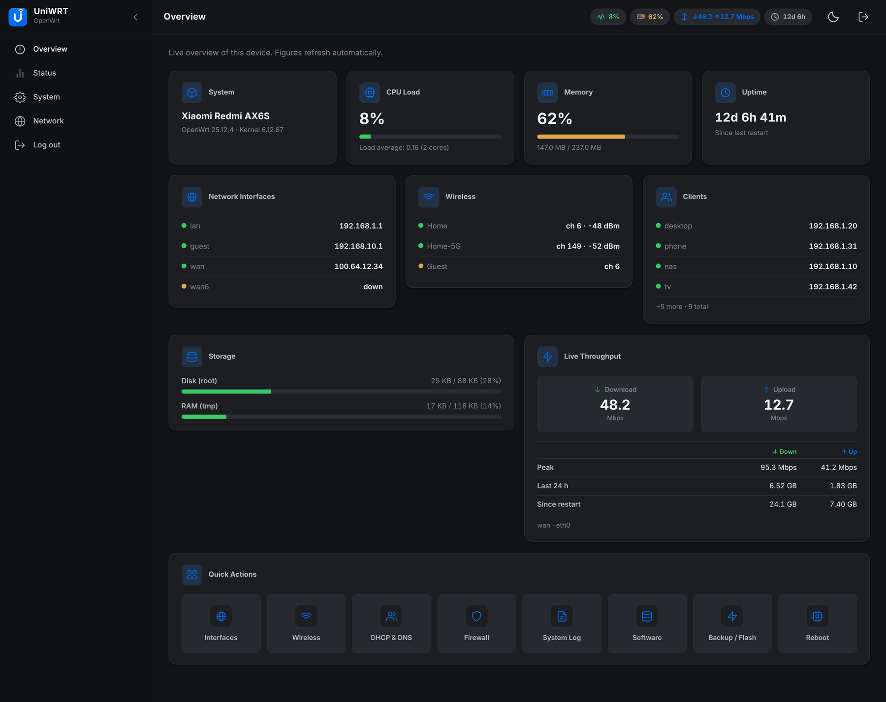
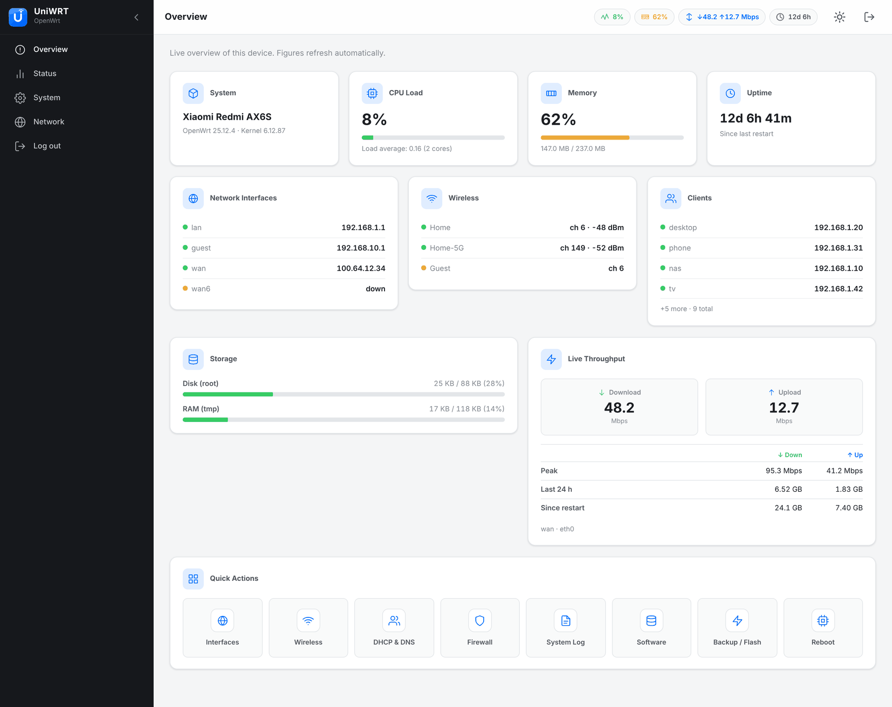
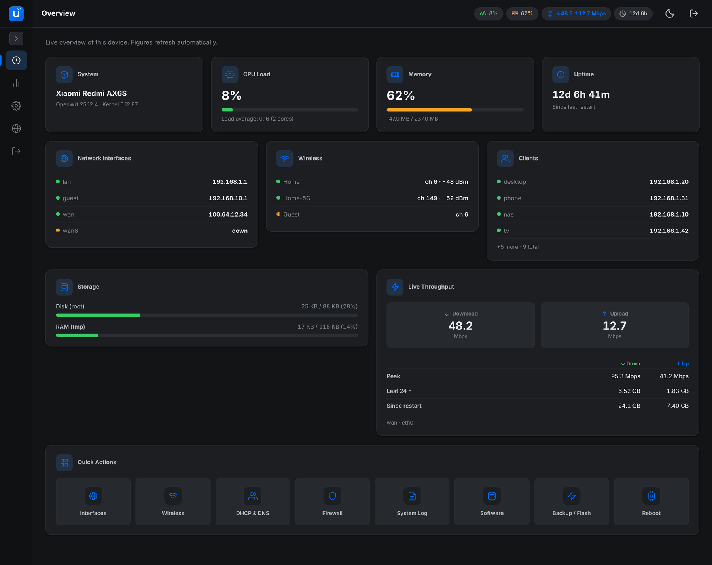
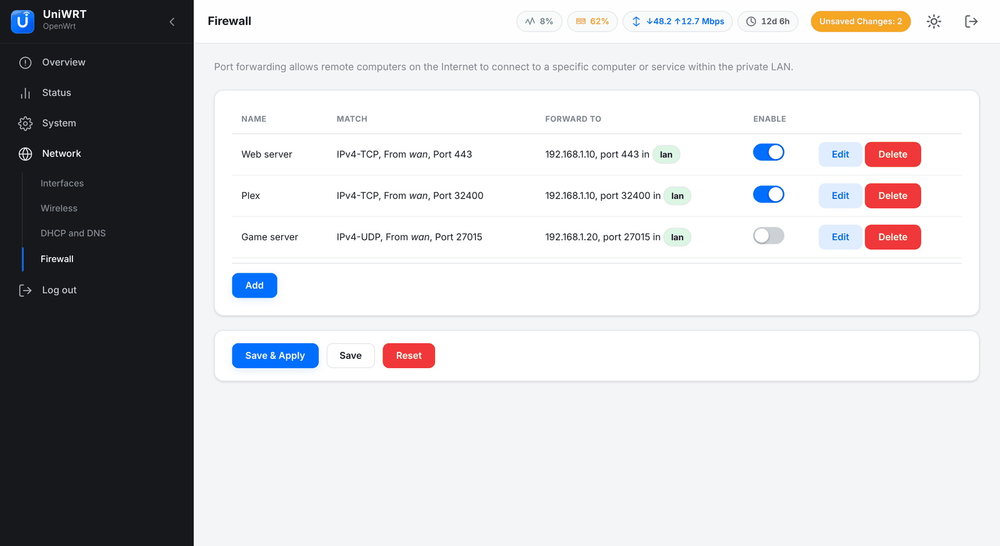
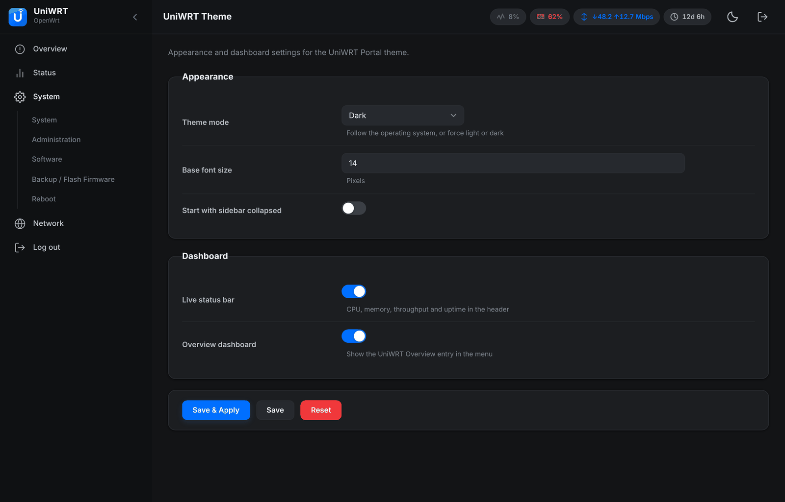
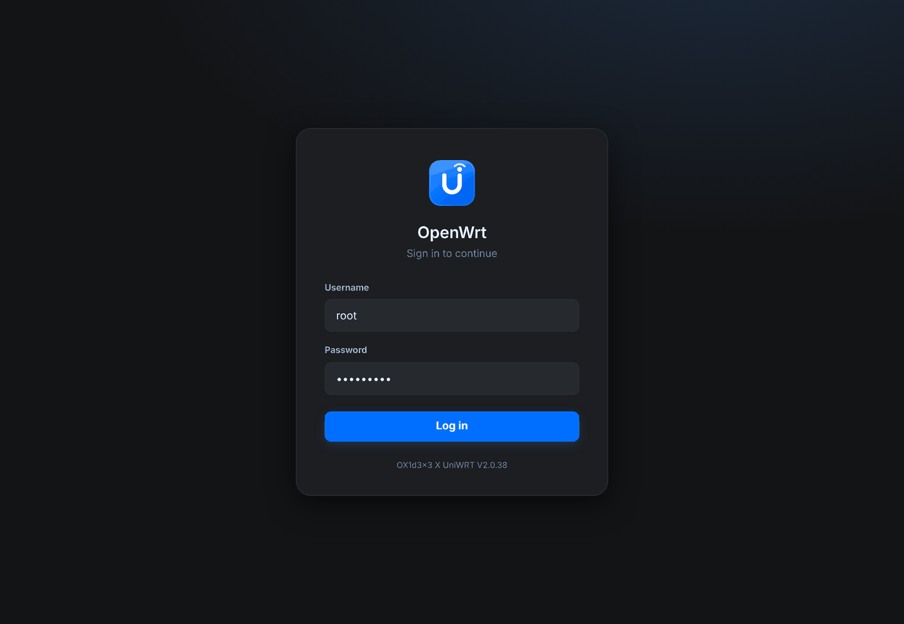
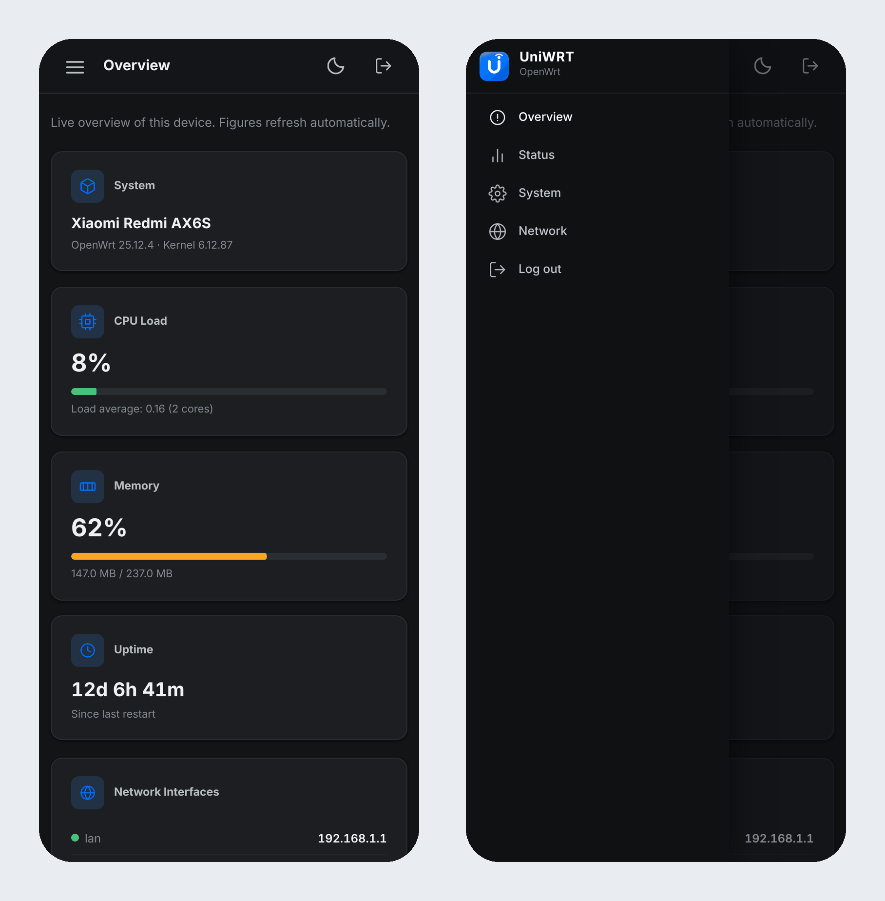

<div align="center">


# UniWRT Portal

**A clean, controller-style theme for the OpenWrt LuCI web interface.**

Icon sidebar · live dashboard · light, dark and auto modes · one small package, zero external requests.

[](https://github.com/ox1d3x3/uniwrt-luci/actions/workflows/build.yml)
[](https://github.com/ox1d3x3/uniwrt-luci/releases/latest)
[](https://github.com/ox1d3x3/uniwrt-luci/releases)
[](https://github.com/ox1d3x3/uniwrt-luci/stargazers)
[](./LICENSE)


[Screenshots](#screenshots) · [Install](#installation) · [Configure](#configuration) · [FAQ](#faq) · [Build](#building-from-source) · [Releases](https://github.com/ox1d3x3/uniwrt-luci/releases/latest)

<br>



</div>

---

## Screenshots

<table>
  <tr>
    <td width="50%"></td>
    <td width="50%"></td>
  </tr>
  <tr>
    <td align="center"><sub><b>Light mode</b></sub></td>
    <td align="center"><sub><b>Collapsed icon rail</b></sub></td>
  </tr>
  <tr>
    <td width="50%"></td>
    <td width="50%"></td>
  </tr>
  <tr>
    <td align="center"><sub><b>Standard LuCI pages, fully styled</b></sub></td>
    <td align="center"><sub><b>Theme settings</b></sub></td>
  </tr>
  <tr>
    <td width="50%"></td>
    <td width="50%"></td>
  </tr>
  <tr>
    <td align="center"><sub><b>Sign-in page</b></sub></td>
    <td align="center"><sub><b>Phones and tablets</b></sub></td>
  </tr>
</table>

---

## Features

**Navigation**
- Sidebar that collapses to a slim icon rail — click any icon to jump straight to that section
- Sticky sub-navigation for the current section, and a menu that remembers its state between pages
- Off-canvas menu on phones and tablets

**Dashboard**
- System, CPU load, memory and uptime at a glance
- Network interfaces, wireless radios and connected clients
- Flash, RAM and swap usage
- Live WAN throughput with peak, last-24-hour and since-boot totals
- Quick-action tiles for the pages you use most

**Appearance**
- Light, dark, or automatic (follows your operating system), switchable from the header
- Separate accent colours for light and dark mode
- Adjustable base font size
- No flash of the wrong theme while a page loads

**Under the hood**
- Live status bar in the header: CPU, memory, throughput and uptime
- Every stock LuCI component styled — tables, tabs, dialogs, tooltips, badges, progress bars, validation states — with checkboxes rendered as switches
- Settings stored in UCI (`/etc/config/uniwrt`) and kept across upgrades
- Architecture-independent `.ipk` and `.apk` packages
- Fully self-contained: no web fonts, no CDNs, no telemetry

---

## Installation

There are two ways to install UniWRT. Both install exactly the same files — the difference is whether the theme is registered with the package manager, which decides whether **Attended Sysupgrade** keeps working.

| | Standalone (recommended) | Package (`.apk` / `.ipk`) |
|---|---|---|
| Attended Sysupgrade (LuCI page and `owut`) | ✅ Works | ❌ Fails until you remove the theme from the request |
| After a firmware upgrade with *Keep settings* | ✅ Theme is still installed | ❌ Theme is gone and must be reinstalled |
| Update | Run the script again | `apk add` / `opkg install` the new file |
| Uninstall | `sh uniwrt-apply.sh --uninstall` | `apk del` / `opkg remove` |

### Standalone install (recommended)

Run on the router (SSH). Works on OpenWrt 23.05, 24.10 and 25.12:

```sh
wget -O /tmp/uniwrt-apply.sh https://github.com/ox1d3x3/uniwrt-luci/releases/latest/download/uniwrt-apply.sh
sh /tmp/uniwrt-apply.sh
```

The script downloads the latest release, verifies it against the release's `SHA256SUMS`, installs it and activates the theme. If UniWRT is already installed as a package, it switches it over to a standalone install and keeps your settings.

| Command | What it does |
|---|---|
| `sh uniwrt-apply.sh` | Install, or update to the latest release |
| `sh uniwrt-apply.sh --version v2.0.39` | Install a specific release |
| `sh uniwrt-apply.sh --file /tmp/luci-theme-uniwrt-standalone.tar.gz` | Install from a downloaded archive (no internet needed on the router) |
| `sh uniwrt-apply.sh --status` | Show the installed version and how it is installed |
| `sh uniwrt-apply.sh --uninstall` | Remove UniWRT and switch LuCI back to Bootstrap |

<details>
<summary><b>How it works</b></summary>
<br>

Attended Sysupgrade asks OpenWrt's build servers for a firmware image containing every installed **package**. The servers only know packages from the official feeds, so a theme installed from a downloaded package makes the request fail.

The standalone install copies the theme's files into place without registering a package, so the upgrade request never mentions it. It records the files in `/lib/upgrade/keep.d/uniwrt-standalone` — OpenWrt's standard list of extra files to keep — so `sysupgrade` carries the theme and your settings into the new firmware whenever *Keep settings* is enabled. The archive is cut from the same build as the `.ipk`, so the files are byte-identical to the package.
</details>

### Package install

Download the package for your OpenWrt release from the [latest release](https://github.com/ox1d3x3/uniwrt-luci/releases/latest), copy it to the router (for example to `/tmp`), then install it:

| OpenWrt | Package manager | File |
|---|---|---|
| **25.12** and newer | apk | `luci-theme-uniwrt-<version>-r1.apk` |
| **24.10** | opkg | `luci-theme-uniwrt_<version>-r1_all.ipk` |
| **23.05** | opkg | `luci-theme-uniwrt_<version>_all.ipk` |

```sh
# OpenWrt 25.12 and newer
apk add --allow-untrusted /tmp/luci-theme-uniwrt-*.apk

# OpenWrt 23.05 / 24.10
opkg install /tmp/luci-theme-uniwrt_*_all.ipk
```

Not sure which you have? Run `command -v apk` on the router — if it prints a path, use the `.apk`. `--allow-untrusted` is needed because the package comes from GitHub rather than a signed OpenWrt feed.

To uninstall: `apk del luci-theme-uniwrt` (25.12+) or `opkg remove luci-theme-uniwrt` (23.05 / 24.10).

### Selecting the theme

A fresh install switches LuCI to UniWRT automatically; updates never override a theme you have chosen since. To select it yourself, go to *System → System → Language and Style*, or run:

```sh
uci set luci.main.mediaurlbase='/luci-static/uniwrt'
uci commit luci
```

After installing or updating, do one hard refresh in the browser (<kbd>Ctrl</kbd>+<kbd>Shift</kbd>+<kbd>R</kbd>, or <kbd>Cmd</kbd>+<kbd>Shift</kbd>+<kbd>R</kbd> on macOS).

---

## Configuration

Open *System → UniWRT Theme* in the web interface, or edit `/etc/config/uniwrt`:

| Option | Values | Default | Description |
|---|---|---|---|
| `mode` | `auto` · `light` · `dark` | `auto` | Default theme mode; `auto` follows the operating system |
| `accent` | `#RGB` or `#RRGGBB` | `#006fff` | Accent colour in light mode |
| `dark_accent` | `#RGB` or `#RRGGBB` | `#4797ff` | Accent colour in dark mode |
| `font_size` | `13` · `14` · `16` · `18` | `14` | Base font size in pixels |
| `status_bar` | `0` · `1` | `1` | Show the live status bar in the header |
| `overview` | `0` · `1` | `1` | Show the UniWRT dashboard in the menu |
| `rail_collapsed` | `0` · `1` | `0` | Start with the sidebar collapsed on desktop |

Invalid values are ignored and the default is used instead.

Example — dark mode with a green accent:

```sh
uci set uniwrt.global.mode='dark'
uci set uniwrt.global.dark_accent='#38cc65'
uci commit uniwrt
```

The theme toggle in the header and the sidebar collapse button are remembered per browser and take precedence over the defaults above.

---

## FAQ

<details>
<summary><b>Attended Sysupgrade fails with “Impossible package selection: missing (luci-theme-uniwrt)”</b></summary>
<br>

This happens when UniWRT is installed as a **package**. Attended Sysupgrade asks the OpenWrt build servers for an image containing every installed package, and those servers only know packages from the official feeds.

**Fix it for good:** switch to the [standalone install](#standalone-install-recommended). It keeps your settings, removes the package, and from then on upgrades work from both the LuCI page and `owut`, with the theme carried into the new firmware:

```sh
wget -O /tmp/uniwrt-apply.sh https://github.com/ox1d3x3/uniwrt-luci/releases/latest/download/uniwrt-apply.sh
sh /tmp/uniwrt-apply.sh
```

**Or, to keep the package,** leave it out of each upgrade and reinstall it afterwards:

1. Enable advanced mode:
   ```sh
   uci set attendedsysupgrade.client.advanced_mode='1'
   uci commit attendedsysupgrade
   ```
2. Reload the Attended Sysupgrade page, remove `luci-theme-uniwrt` from the **Packages** list, then build and flash with *Keep settings* enabled.
3. After the reboot, reinstall the package. Your settings are preserved.

On the command line, `owut upgrade --remove luci-theme-uniwrt` does the same.
</details>

<details>
<summary><b>LuCI is unstyled after a firmware upgrade</b></summary>
<br>

A firmware upgrade removes manually installed packages but keeps `/etc/config`, so LuCI is still set to a theme that is no longer there. Reinstall UniWRT — ideally with the [standalone install](#standalone-install-recommended), which survives future upgrades — or switch back to the stock theme:

```sh
uci set luci.main.mediaurlbase='/luci-static/bootstrap'
uci commit luci
```

A standalone install is only carried over when *Keep settings* is enabled during the upgrade.
</details>

<details>
<summary><b>The page looks broken or half-updated after upgrading the theme</b></summary>
<br>

The browser is using a cached stylesheet from the previous version. Do one hard refresh (<kbd>Ctrl</kbd>+<kbd>Shift</kbd>+<kbd>R</kbd> / <kbd>Cmd</kbd>+<kbd>Shift</kbd>+<kbd>R</kbd>). Assets are versioned per release, so this should only be needed once.
</details>

<details>
<summary><b>A menu entry doesn’t appear or disappear after changing a setting</b></summary>
<br>

LuCI caches its menu. Clear the cache and reload:

```sh
rm -f /tmp/luci-indexcache* /tmp/luci-modulecache/*
```
</details>

<details>
<summary><b>Does the theme make any external requests?</b></summary>
<br>

No. All assets are served from the router, and every figure on the dashboard comes from your device over `ubus`. There are no web fonts, CDNs, analytics or update checks.
</details>

---

## Compatibility

| | |
|---|---|
| **OpenWrt** | 23.05, 24.10, 25.12 and newer |
| **Packages** | `.ipk` (opkg) and `.apk` (apk), architecture-independent |
| **Requirements** | `luci-base` with the ucode template engine (default on all supported releases) |
| **Browsers** | Current Chrome, Edge, Firefox and Safari, desktop and mobile |

Third-party LuCI apps generally work without changes, since UniWRT styles the standard LuCI components they are built from. If one doesn’t render correctly, please [open an issue](https://github.com/ox1d3x3/uniwrt-luci/issues).

---

## Building from source

Every push to `main` runs a static QA gate, builds packages for all supported releases with the OpenWrt SDK, cuts the standalone archive from the 24.10 `.ipk` and tests `uniwrt-apply.sh` against it, and refreshes the rolling [`nightly`](https://github.com/ox1d3x3/uniwrt-luci/releases/tag/nightly) pre-release.

**Releasing** is automatic: bump the version in [`luci-theme-uniwrt/ucode/template/themes/uniwrt/version`](luci-theme-uniwrt/ucode/template/themes/uniwrt/version) and push to `main`. When CI sees a version that has no `v<version>` tag yet, it tags the commit, publishes the release with all packages, checksums and generated notes, and marks it **Latest**. Pushing a `v*` tag by hand still works too.

To build locally inside an OpenWrt SDK:

```sh
echo "src-link uniwrt /path/to/uniwrt-luci" >> feeds.conf.default
./scripts/feeds update uniwrt
./scripts/feeds install -a -p uniwrt

make menuconfig                              # LuCI → 4. Themes → luci-theme-uniwrt
make package/luci-theme-uniwrt/compile V=s
```

The package is written to `bin/packages/<arch>/uniwrt/`.

<details>
<summary><b>Repository layout</b></summary>
<br>

```
luci-theme-uniwrt/
├── Makefile                         package definition (version read from ucode/.../version)
├── htdocs/luci-static/
│   ├── uniwrt/css/                  cascade.css (light + layout), dark.css (inlined at runtime)
│   ├── uniwrt/img/                  logo
│   └── resources/                   menu and status-bar renderers, dashboard and settings views
├── ucode/template/themes/uniwrt/    header.ut, footer.ut, sysauth.ut, version
└── root/                            default config, uci-defaults, menu and ACL entries
scripts/make-standalone.sh           cuts the standalone archive from the built .ipk
tests/test-apply.sh                  tests uniwrt-apply.sh in a simulated router (BusyBox)
qa-static.sh                         static checks run in CI
uniwrt-apply.sh                      on-router installer (standalone / package / uninstall)
```
</details>

---

## Contributing

Bug reports and pull requests are welcome. For rendering issues, please include:

- the page you were on (for example *Network → Firewall → Port Forwards*)
- your OpenWrt version and router model
- the browser you used and a screenshot

Run the static checks before opening a pull request:

```sh
./qa-static.sh
```

Changes to `uniwrt-apply.sh` are tested in CI against the real build with `tests/test-apply.sh` (needs `busybox`).

## Security

Please don’t report security problems in public issues. Use [private vulnerability reporting](https://github.com/ox1d3x3/uniwrt-luci/security/advisories/new) instead — see [SECURITY.md](./SECURITY.md).

## Changelog

Release notes for every version are on the [Releases](https://github.com/ox1d3x3/uniwrt-luci/releases) page.

---

<div align="center">

Made by [ox1d3x3](https://github.com/ox1d3x3) · Licensed under [Apache 2.0](./LICENSE)

UniWRT is an independent project and is not affiliated with or endorsed by OpenWrt or any network equipment vendor.

If UniWRT is useful to you, a ⭐ helps others find it.

</div>
